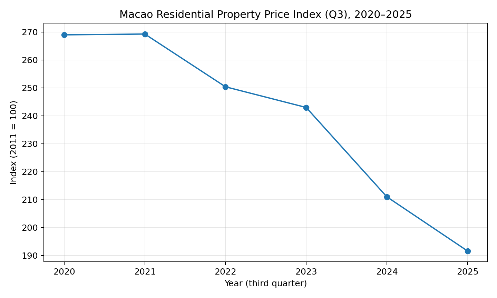

# Data Science Portfolio

# About Me
Hi, I'm ZHU LINGJING. I'm taking CISC7204 and this is my first attempt at building a public data science portfolio. For this project, I explored a DSEC dataset to see how Macao's property prices changed between Q3 2020 and Q3 2025. I'm still learning, but I hope this portfolio shows my progress and makes the data easy to understand.

# Technical Skills
- Python (basic data analysis)
- Jupyter Notebook
- pandas
- Matplotlib
- Data visualization and descriptive analysis
- GitHub and GitHub Pages (learning)

# Project Showcase

# Macao Residential Property Price Index: Q3 Comparison, 2020–2025

Research question: How did Macao's overall residential property price index change between the third quarters of 2020 and 2025?

Project status: Ongoing

Main finding: The overall index was nearly unchanged between Q3 2020 (269.0) and Q3 2021 (269.3), then declined across the following third-quarter observations, reaching 191.6 in Q3 2025. This is a descriptive comparison of the index, not a direct measure of housing affordability or an explanation of why prices changed.

The line chart makes the overall trend easier to see. A second chart in the project repository shows the percentage change between consecutive third-quarter observations.It clearly shows a continuous decline after the peak in 2021.
(Updated: Based on a classmate's feedback, I added a more specific explanation for the line chart to highlight the continuous decline after 2021.)

Project repository: 
https://github.com/mc660478/data-science-project

# What I Plan to Improve
Next, I plan to verify and document the data more fully, expand the time-series analysis if suitable official data are available, and improve the explanations so readers can distinguish property-price movements from housing affordability.