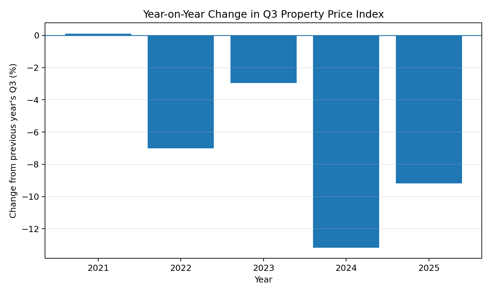

# ZHU LINGJING — Data Science Portfolio

## About Me

Hi, I'm ZHU LINGJING, a student in CISC7204. This is the first time I've made a portfolio website, so I kept it simple. For my project I used Python in Jupyter Notebook to look at official statistics about Macao's housing market, and I put the charts and notes here so that anyone can see what I found and how I got there.

## Technical Skills

- Python (pandas, Matplotlib)
- Jupyter Notebook
- Basic descriptive statistics and data visualization
- Git and GitHub (still getting used to it)

## Project Showcase

### Macao Residential Property Price Index: Q3 Comparison, 2020–2025

**Research question:** How did Macao's overall residential property price index change between the third quarters of 2020 and 2025?

**Status:** Ongoing. This is the first step of my semester project, which was proposed in my Assignment 01 preliminary proposal.

**Findings:** The index barely moved from Q3 2020 (269.0) to Q3 2021 (269.3), and after that it went down in every later third-quarter observation, ending at 191.6 in Q3 2025. That is about 28.8% below the Q3 2020 level. I want to be careful with this claim: it only describes the index itself. It does not explain why prices fell, and on its own it says nothing about whether housing in Macao is affordable.

**Limitation:** The dataset has only six numbers. I did not use income, mortgage cost, or individual transaction prices, so this analysis cannot measure affordability directly.

This chart shows the level of the index. The drop after 2021 is easy to miss if you only read the numbers in a table, but it is obvious here.

This second chart shows the percentage change between each pair of third quarters. It makes the pattern clearer: almost no change at first, then steady declines.

*Update: a classmate read my first draft and said the trend chart needed more explanation. I rewrote the chart captions and added this year-on-year chart, so the page now shows both the level and the pace of the decline. The change is recorded in the commit history.*

**Project repository:** [data-science-project](https://github.com/mc660478/data-science-project)

## What I Plan to Improve Next

My semester project proposal plans to compare housing prices with employment earnings using DSEC data. As that project moves forward I will update this page with the new results. I would also like to redo the analysis on the full monthly index series instead of just six Q3 values, if the official data allows it.
